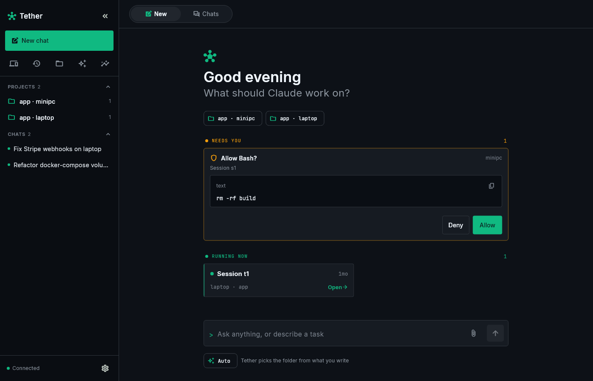
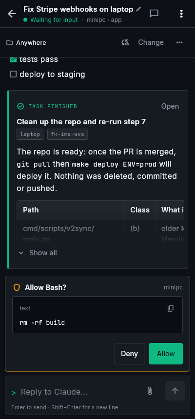
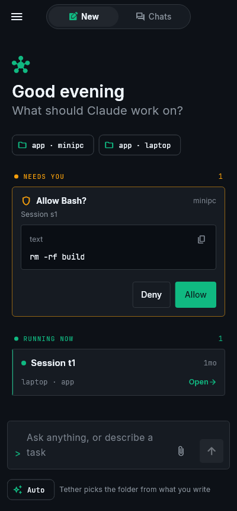
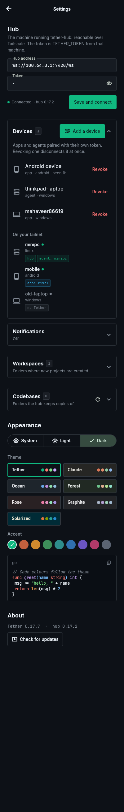
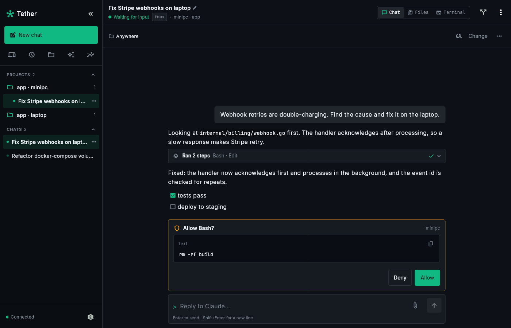
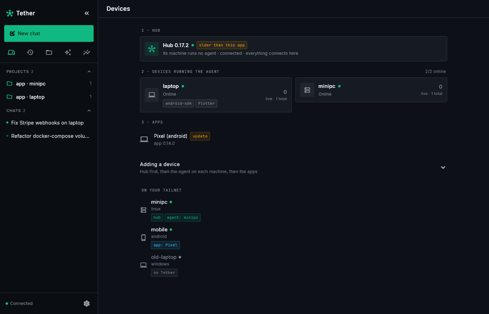
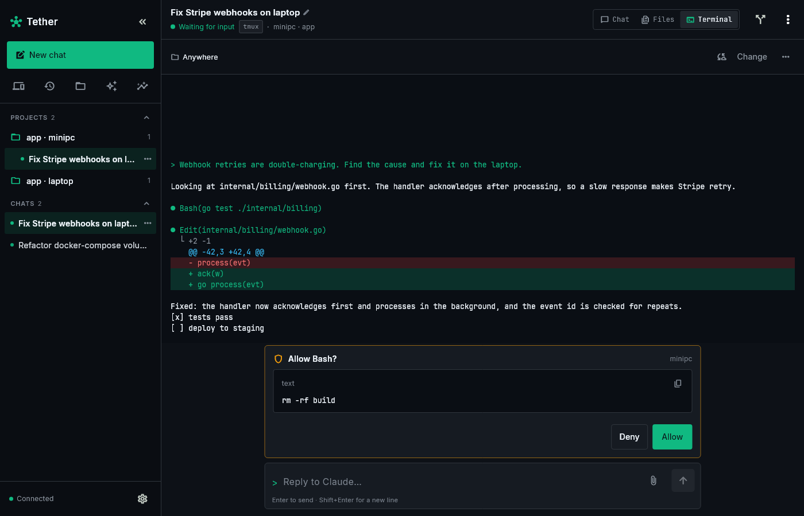
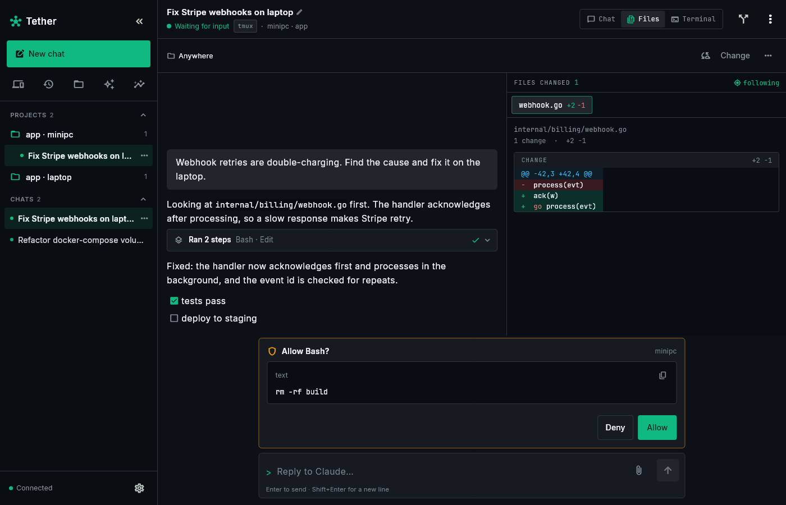

<div align="center">

# Tether

**Every Claude Code session on every machine you own, in one app.**

A self-hosted control plane for [Claude Code](https://claude.com/claude-code): watch, steer and approve work from your phone or desktop, over your own Tailscale network. Nothing is public and nothing leaves your tailnet.

[](https://github.com/Mahaveer86619/tether/actions/workflows/ci.yml)
[](https://github.com/Mahaveer86619/tether/releases/latest)


[Get started](docs/getting-started/README.md) · [Download](https://github.com/Mahaveer86619/tether/releases/latest) · [Documentation](docs/README.md) · [Contribute](CONTRIBUTING.md)



</div>

## Why Tether

Claude Code's terminal interface is excellent at one session in one terminal. Tether is for when you have several: one on the laptop, a few running in a sandbox on a home server, one you started this morning and want to check from your phone.

You see them all live, read their output properly rendered, approve their tool calls, continue or fork them, and start new ones on any machine, from one chat box.

## Features

| | |
|---|---|
| **Chat first** | Say what you want in one box. Tether picks the machine and folder (or you do), starts the work there and keeps the conversation in one chat, even when the work spans machines. |
| **Every session, one place** | Sessions on every device, including ones started in a terminal, rendered as Markdown, tables, code, diffs, checklists and tool cards. Claude is never told how to format its answers. |
| **A chat that leads** | The session you talk to hands work to task sessions on your other machines and reports back, as a card in the chat. |
| **Approvals from anywhere** | Permission prompts, plans and Claude's questions arrive in the app. Answer from the phone or the desktop. |
| **Remote projects** | Move a chat's project to another device. The code stays in step through a git repo on your hub and secrets travel through a sealed vault, only to devices you allow. |
| **Continue anywhere** | Resume a laptop session from your phone, fork it, or carry it on to the home server. |
| **Files both ways** | Attach anything from the phone; files Claude makes are kept on the hub and open from any device. |
| **A second brain** | A small Rust service remembers decisions and notes, links them to code symbols, and serves them to Claude over MCP. |
| **Learns your routines** | Requests you keep making can become skills, only with your approval. |
| **Updates itself** | One version for hub, agents and apps; the apps and agents update from the hub. |

The full list with status is in [docs/product/features.md](docs/product/features.md).

<div align="center">

&nbsp;&nbsp;

&nbsp;&nbsp;

</div>

<details>
<summary>More screens</summary>






</details>

## How it fits together

```
               Flutter app (Android + Windows)
                        │  WebSocket, over Tailscale only
                        ▼
  ┌──────────────── tether-hub (always on) ─────────────────┐
  │ session index · event log (SQLite) · renderer · scheduler│
  │ approvals · files · git for remote projects · MCP server │
  └──────▲──────────────────────────────────▲───────────────┘
         │ outbound WebSocket               │ outbound WebSocket
   tether-agent (Windows laptop)      tether-agent (Linux server)
   ├ runs `claude` sessions           ├ runs sessions in tmux or headless
   └ mirrors terminal sessions        └ registers the second brain
```

- **Hub**: the one always-on machine. It indexes sessions, keeps the event log, renders output into typed blocks, and routes approvals and commands.
- **Agent**: runs on each machine that has Claude Code. It dials out to the hub, so no inbound ports are opened.
- **App**: a client of the hub only.

How it works in depth: [docs/architecture/architecture.md](docs/architecture/architecture.md).

## Get started

Pick the path that fits:

| I want to... | Go to |
|---|---|
| **Use Tether**: download a release and set it up | [Using a release](docs/getting-started/using-releases.md) |
| **Build it myself** from a clone | [From source](docs/getting-started/from-source.md) |
| **Contribute** | [CONTRIBUTING.md](CONTRIBUTING.md) |

In short: you need [Tailscale](https://tailscale.com) on every device and [Claude Code](https://claude.com/claude-code) on every machine that runs sessions. Install the hub on an always-on machine, the agent on each machine, then the app. Updates go in the same order.

## Tech

| Part | Stack |
|---|---|
| Hub, agent, `tetherctl` | Go, `coder/websocket`, pure-Go SQLite (`modernc.org/sqlite`), `goldmark` |
| Wire contract | Protocol Buffers via `buf`, generated for Go and Dart |
| App | Flutter (Android, Windows), BLoC/Cubit, `get_it`, `package:http` |
| Second brain | Rust, SQLite, MCP over stdio and HTTP |
| Delivery | GitHub Actions; a self-hosted runner deploys the hub; signed APK and Windows installer with auto-update |

## Repository layout

```
proto/       the wire contract: the source of truth for hub, agent and app
server/      Go: hub, agent and tetherctl            → server/README.md
app/         Flutter app for Android and Windows     → app/README.md
brain/       the second brain, in Rust               → brain/README.md
deploy/      systemd units, Windows installers, CI runner setup → deploy/README.md
tools/       release scripts, icon generation
docs/        product, architecture, design, plans, operations   → docs/README.md
```

## Status

Version 0.18, working end to end on the author's setup: a Windows laptop, a home server and a phone. Chats, sessions across machines, approvals, remote projects, files of any size, the second brain, signed in-app updates and a connection doctor are built. A pass over every screen before 1.0 is planned in [docs/design/ui-overhaul.md](docs/design/ui-overhaul.md); see also the [roadmap](docs/product/roadmap.md).

## Documentation

Everything is indexed in [docs/README.md](docs/README.md). Good places to start: [overview](docs/product/overview.md), [architecture](docs/architecture/architecture.md), [security](docs/architecture/security.md) and [releasing](docs/operations/releasing.md).
